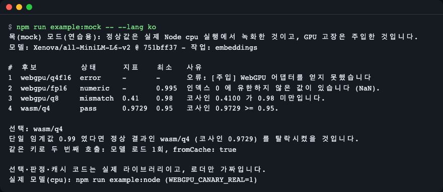
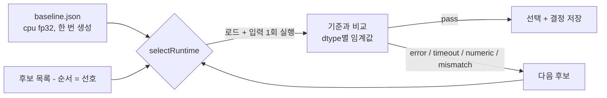
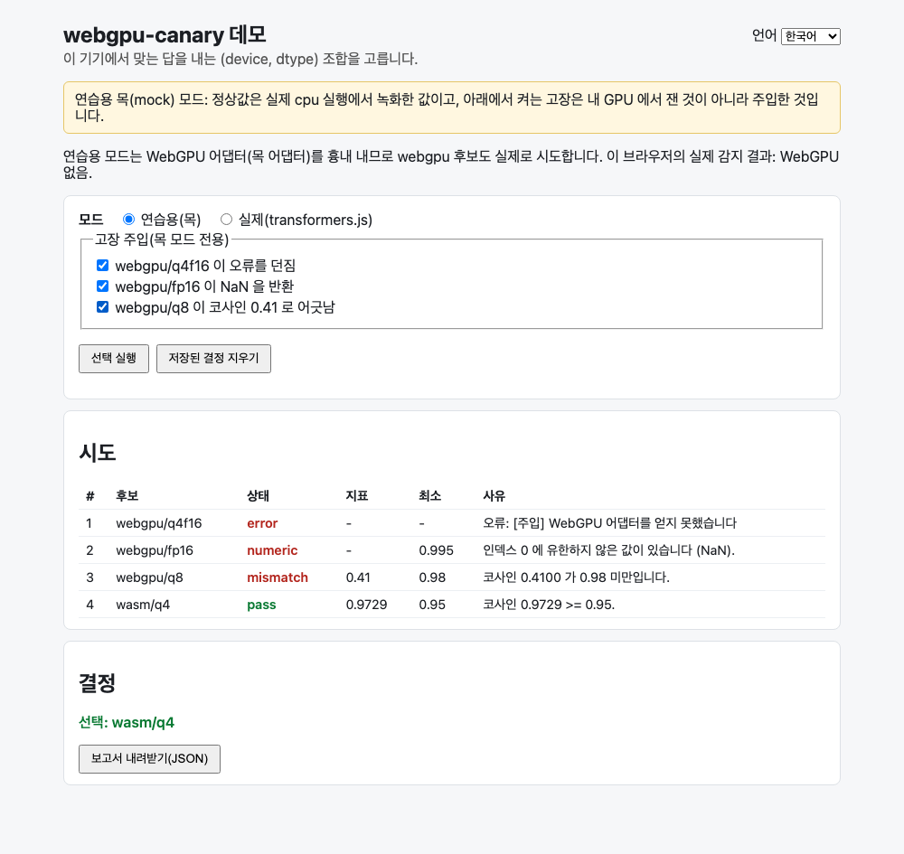
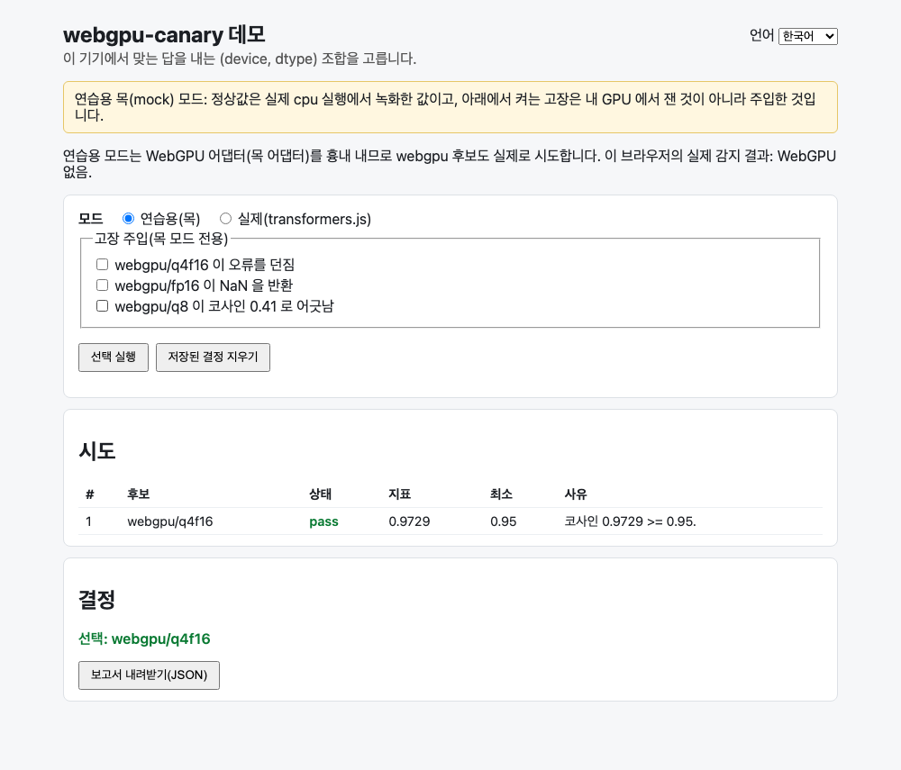

# webgpu-canary

[English](README.md) | **한국어**

브라우저에서 [transformers.js](https://huggingface.co/docs/transformers.js)를 쓸 때 **이 기기에서 맞는 답을 내는** 장치(device)와 정밀도(dtype)를 골라 줍니다. 앱이 시작될 때 `selectRuntime()` 이 (device, dtype) 후보를 차례로 로드하고, 짧은 고정 입력 하나를 돌려, cpu·fp32 로 한 번 만들어 둔 기준 출력과 비교합니다. 출력이 맞는 첫 후보가 선택되고, 결정은 다음 방문을 위해 저장됩니다.

흔한 `try { webgpu } catch { wasm }` 은 오류만 잡습니다. 일부 GPU·dtype 조합은 **오류 없이 틀린 숫자**(NaN, 같은 토큰 반복)를 돌려줍니다. 이 라이브러리는 그것도 잡습니다.



*연습용(목) 실행: 앞의 세 후보는 서로 다른 방식으로 실패하고 네 번째가 통과합니다.*

## 설치

```bash
npm install webgpu-canary
npm install @huggingface/transformers   # transformers.js 로더를 쓸 때만
npm install react                       # React 훅을 쓸 때만
```

CLI·테스트에는 Node 20 이상이 필요하고, 라이브러리 자체는 모든 브라우저에서 돕니다(WebGPU 가 있으면 WebGPU, 어디서나 WASM). 코어는 **런타임 의존성이 0개**이며 `@huggingface/transformers`(^4.3.2)와 `react`(>=18)는 선택 peer 입니다.

내 프로젝트에 넣지 않고 먼저 써 보려면:

```bash
git clone https://github.com/LeeGyeongPil/webgpu-canary.git
cd webgpu-canary
npm install
npm run example:mock
```

GitHub 에서 바로 설치(`npm install github:LeeGyeongPil/webgpu-canary`)해도 됩니다. 설치 중 `prepare` 스크립트가 `dist/` 를 빌드합니다. 그래도 npm 레지스트리 패키지가 더 간단합니다.

## 빠르게 시작하기

세 단계입니다. 기준 출력을 한 번 만들고, 선호 순서대로 후보를 적어 `selectRuntime()` 에 넘깁니다.

```bash
# 1. 기준 출력(cpu, fp32). 모델 개정판(커밋 sha)을 고정하세요. 빌드 때 한 번 만듭니다.
npx webgpu-canary baseline Xenova/all-MiniLM-L6-v2 --task embeddings \
  --revision 751bff37182d3f1213fa05d7196b954e230abad9 --lang ko --out baseline.json
```

```text
baseline.json 를 썼습니다 (embeddings, 값 384개, 개정판 751bff37182d3f1213fa05d7196b954e230abad9).
```

```js
// 2. 앱 시작 때 (여기서는 Node 로 보여 줍니다. 브라우저에서는 "cpu" 대신 device "wasm")
import { selectRuntime } from 'webgpu-canary';
import { transformersLoader } from 'webgpu-canary/transformers';
import baseline from './baseline.json' with { type: 'json' };

const { candidate, runner, report } = await selectRuntime({
  modelId: baseline.modelId,
  revision: baseline.revision,
  task: 'embeddings',
  baseline,
  loader: transformersLoader(),
  candidates: [
    { device: 'webgpu', dtype: 'fp16' },
    { device: 'cpu', dtype: 'q4' },
  ],
});
console.log('chosen:', candidate);
console.log(report.attempts.map((a) => a.status));
await runner.dispose();
```

```text
chosen: { device: 'cpu', dtype: 'q4' }
[ 'skipped', 'pass' ]
```

Node 에는 `navigator.gpu` 가 없으므로 WebGPU 후보는 아무것도 로드하지 않고 `skipped`(`no-webgpu`)가 됩니다. WebGPU 가 있는 브라우저에서는 로드해 확인합니다. WebGPU 가 있다고 알리지만 시작하지 못하는 환경이면 상태가 `error` 가 되고 다음 후보로 넘어갑니다.

## 핵심 개념



- **후보(candidate)**: `webgpu/fp16`, `wasm/q4` 같은 `{ device, dtype }` 한 쌍. 순서가 곧 선호입니다.
- **기준 출력(baseline)**: 같은 모델·같은 입력을 cpu·fp32 로 돌린 결과. CLI 로 한 번 만들어 앱과 함께 배포하는 작은 JSON 파일입니다.
- **상태**: `pass`, `error`(로드·실행 중 예외), `timeout`, `numeric`(NaN·Infinity·영벡터, 또는 한 토큰 여러 번 반복), `mismatch`(값은 유한하지만 기준에서 너무 멂), `skipped`(이 환경에서는 불가능, 아무것도 로드하지 않음).
- **dtype별 임계값**: 양자화 dtype 은 원래 fp32 와 조금 다릅니다. `Xenova/all-MiniLM-L6-v2` 실측(fp32 대비 코사인, Node cpu, 2026-11-16): q8 0.9906, fp16 0.999999, q4 0.9729, q4f16 0.9729. 임계값 하나(0.99)면 정상인 q4 를 탈락시키므로 dtype마다 기본값이 따로 있습니다([API](#api) 참고).
- **결정 캐시**: 어댑터·브라우저 주 버전·모델·모델 개정판·작업·라이브러리 버전으로 만든 키로 저장합니다. 하나라도 바뀌면 다시 확인합니다. 저장된 결정도 방문마다 입력 1회로 검증하고, 실패하면 버립니다.

## API

따로 적지 않으면 `webgpu-canary` 에서 가져옵니다.

| 이름 | 하는 일 | 주요 인자 | 반환 |
|---|---|---|---|
| `selectRuntime(options)` | 후보를 차례로 시도해 처음 통과한 것을 돌려줌 | `modelId`, `revision`, `task`(`embeddings`·`text-generation`), `candidates`, `baseline`, `loader`; 선택: `store`, `env`, `availableDtypes`, `thresholds`, `timeoutMs`(120000), `graceMs`(5000), `libVersion`, `onAttempt`, `signal` | `Promise<{ runner, candidate, report }>`; `NoCandidatePassedError`·`CanaryConfigError`·`CanaryAbortedError` 를 던짐 |
| `judgeEmbedding(vec, base, dtype, overrides?)` | 임베딩 판정(코사인) | 벡터, 기준 벡터, dtype | `Verdict`(`status`, `reason`, 지표) |
| `judgeGeneration(tokens, base, dtype, overrides?)` | 탐욕 생성 토큰 판정(앞부분 일치, 반복 토큰) | 토큰 id, 기준 id, dtype | `Verdict` |
| `DEFAULT_THRESHOLDS`, `resolveThreshold(dtype, overrides?)` | dtype별 최소값(`minCosine`, `minPrefix`) | dtype 문자열 또는 모듈별 객체 | `{ minCosine, minPrefix }`; 기본값 없는 dtype 은 `CanaryConfigError` |
| `makeBaseline(options)` | 코드로 기준 출력 만들기(CLI 가 사용) | `modelId`, `revision`, `task`, `loader`, `libVersion`, 선택 `input`, `maxNewTokens` | `Promise<Baseline>` |
| `detectEnv()` / `emptyEnv()` | 브라우저 확인: WebGPU, `shader-f16`, 어댑터 정보 | 없음 | `Promise<EnvInfo>` / `EnvInfo` |
| `cacheKey(parts)` | 결정 저장 키 | `env`, `modelId`, `revision`, `task`, `libVersion` | `string` |
| `memoryStore()`, `localStorageStore(prefix?)` | 결정을 기억하는 곳 | - | `DecisionStore` |
| `formatAttempts(attempts, lang)`, `reasonText(attempt, lang)`, `candidateName(c)`, `t`, `resolveLang`, `LANGS` | 시도 표 문자열, 시도 하나의 사유를 고른 언어로, 영어·한국어 메시지(보고서에는 영어 `reason` 도 그대로 남음) | - | `string[]` / `string` |
| `transformersLoader(options?)` (`webgpu-canary/transformers`) | `@huggingface/transformers` v4 로더: 평균 풀링·정규화 임베딩, 탐욕 생성(토크나이저에 채팅 템플릿이 있으면 적용) | `progress_callback`, `cacheDir`, `module` | `Loader` |
| `useCanaryRuntime(options)` (`webgpu-canary/react`) | React 훅: 마운트 때 선택 실행, 언마운트 때 정리 | `selectRuntime` 과 같음 + `enabled` | `{ status: 'idle'\|'probing'\|'ready'\|'failed', attempts, runner, candidate, report, error }` |
| `fakeLoader(plan)`, `fixtures`, `runMockDemo` (`webgpu-canary/testing`) | 고장을 주입하는 가짜 로더(`error`·`nan`·`zero`·`repeat`·`drift`·`delay`)와 실측 벡터 | `plan: Record<'device/dtype', Behavior>` | `stats` 가 있는 `FakeLoader` |
| `webgpu-canary baseline <modelId>` (CLI) | 기준 출력 JSON 작성 | `--task`, `--revision`(필수), `--input`, `--max-new-tokens`, `--out`, `--lang en\|ko` | 종료 코드 0 성공, 1 모델 실패, 2 잘못된 인자 |

`Candidate`, `Baseline`, `Report`, `Attempt`, `Status`, `Loader`, `Runner`, `DecisionStore` 같은 타입도 내보냅니다. transformers.js 가 아닌 런타임용 `Loader` 를 직접 만들 수 있습니다. 판정·선택 코드는 transformers.js 를 전혀 모릅니다.

기본 임계값(`thresholds: { q4: { minCosine: 0.9 } }` 로 덮어씀):

| dtype | minCosine | minPrefix(토큰) |
|---|---|---|
| fp32 | 0.999 | 4 |
| fp16 | 0.995 | 4 |
| q8, int8, uint8 | 0.98 | 3 |
| q4, bnb4, q4f16 | 0.95 | 3 |

목록에 없는 dtype(예: `q2`)은 아무것도 로드하기 전에 `CanaryConfigError` 를 던집니다. 기준에서 얼마나 벗어나는지 재 보고 임계값을 직접 넘기세요.

## 사용 예

### 1. 고장 주입 연습 (네트워크 없음)

```bash
npm run example:mock -- --lang ko
```

```text
목(mock) 모드(연습용): 정상값은 실제 Node cpu 실행에서 녹화한 것이고, GPU 고장은 주입한 것입니다.
모델: Xenova/all-MiniLM-L6-v2 @ 751bff37 - 작업: embeddings

#  후보          상태      지표    최소   사유
1  webgpu/q4f16  error     -       -      오류: [주입] WebGPU 어댑터를 얻지 못했습니다
2  webgpu/fp16   numeric   -       0.995  인덱스 0 에 유한하지 않은 값이 있습니다 (NaN).
3  webgpu/q8     mismatch  0.41    0.98   코사인 0.4100 가 0.98 미만입니다.
4  wasm/q4       pass      0.9729  0.95   코사인 0.9729 >= 0.95.

선택: wasm/q4
단일 임계값 0.99 였다면 정상 결과인 wasm/q4 (코사인 0.9729) 를 탈락시켰을 것입니다.
같은 키로 두 번째 호출: 모델 로드 1회, fromCache: true

선택·판정·캐시 코드는 실제 라이브러리이고, 로더만 가짜입니다.
실제 모델(cpu): npm run example:node (WEBGPU_CANARY_REAL=1)
```

이것은 **연습용 목(mock) 모드**입니다. 정상 벡터는 Node cpu 에서 실제로 녹화한 값이지만, 세 가지 GPU 고장은 주입한 것입니다(고장 난 실제 GPU 를 마음대로 재현할 수 없기 때문). 선택·판정·캐시 코드는 실제 라이브러리입니다.

### 2. Node cpu 에서 실제 모델

```bash
WEBGPU_CANARY_REAL=1 NODE_USE_ENV_PROXY=1 npm run example:node
```

`Xenova/all-MiniLM-L6-v2` 를 한 번 내려받고 `webgpu/fp16`, `cpu/q4`, `cpu/q8` 을 시도한 뒤 표를 출력하고 `out/report.json` 을 씁니다. 우리 실행에서는 `cpu/q4` 가 코사인 0.9729 로 통과했고, WebGPU 후보는 그 환경에 WebGPU 어댑터가 없어 `error` 로 기록됐습니다. HTTP(S) 프록시 뒤에서는 `NODE_USE_ENV_PROXY=1` 을 설정하세요(Node 내장 fetch 가 프록시를 씁니다).

### 3. React 훅

```tsx
import { useCanaryRuntime } from 'webgpu-canary/react';
import { transformersLoader } from 'webgpu-canary/transformers';
import { localStorageStore } from 'webgpu-canary';

function Search({ baseline }) {
  const canary = useCanaryRuntime({
    modelId: baseline.modelId, revision: baseline.revision, task: 'embeddings', baseline,
    loader: transformersLoader(), store: localStorageStore(),
    candidates: [{ device: 'webgpu', dtype: 'fp16' }, { device: 'wasm', dtype: 'q8' }],
  });
  if (canary.status === 'failed') return <p>No safe runtime here: {canary.error?.message}</p>;
  if (canary.status !== 'ready') return <p>Checking this device… {canary.attempts.length} tried</p>;
  // canary.runner.run('text', {}) 는 { vector } 를 돌려줌
  return <p>Using {canary.candidate.device}/{canary.candidate.dtype}</p>;
}
```

훅의 상태 전이(`idle` → `probing` → `ready`/`failed`, 실시간 `attempts`, 언마운트 시 정리)는 `test/react.test.tsx` 가 검증합니다. 이 코드 조각은 API 를 보여 주는 예이며 브라우저에서 실행해 보지는 않았습니다.

### 4. 브라우저 데모 페이지 (영어·한국어)

```bash
npm run demo:build   # 정적 파일이 demo-dist/ 에 생김
npm run demo:dev     # 또는 로컬 개발 서버
```



*데모 페이지, 연습 모드에서 주입 고장 세 가지를 모두 켠 상태.*



*주입 고장을 끄면 첫 후보가 통과하고 다른 후보는 시도하지 않습니다.*

페이지에는 언어 메뉴(English / 한국어)가 있고 선택은 `localStorage` 에 저장됩니다(주소의 `?lang=ko` 가 가장 우선). 기본은 연습(목) 모드입니다. WebGPU 어댑터를 흉내 내고 고장을 주입하며, 페이지가 그렇게 표시하면서 실제 감지 결과도 함께 보여 줍니다. "실제 모드"는 브라우저에서 transformers.js 를 돌려 모델을 내려받습니다.

이 릴리스를 준비한 환경에서는 **실제 WebGPU 를 검증하지 못했습니다**. 직접 확인하려면 `npm run demo:build` 후 `demo-dist/` 를 서빙하거나 `npm run demo:dev` 를 실행하고, 샌드박스나 원격 컨테이너가 아닌 일반 데스크톱 세션의 Chrome·Edge 또는 Safari 26+ 로 열어 실제 모드로 바꾼 뒤 시도 표를 읽으세요. Chrome·Edge 와 Safari 26+ 는 WebGPU 를 제공하고, 모든 브라우저가 WASM 후보를 쓸 수 있습니다.

## 언어

CLI·예제: `--lang en|ko`, 다음 `WEBGPU_CANARY_LANG`, 다음 `LC_ALL` / `LC_MESSAGES` / `LANG`(`ko` 로 시작하면 한국어, 아니면 영어). 데모 페이지는 언어 메뉴를 씁니다.

```bash
npm run example:mock -- --lang ko
```

## 언제 쓰나

- 잘 맞는 경우: 클라이언트에서 transformers.js(임베딩·소형 텍스트 생성)를 돌리는 웹 앱이고, 일부 사용자 GPU 에서 틀린 결과가 보이면 안 될 때. 선택을 실측하고 캐시하며 보고서로 설명하고 싶을 때.
- 목적이 아닌 것: 속도 벤치마크. 후보별 로드 시간은 기록하지만 후보는 경주가 아니라 정해 둔 선호 순서로 시도합니다.
- 다른 도구: 브라우저가 보고하는 WebGPU 기능을 보려면 [webgpureport.org](https://webgpureport.org/), 모델 런타임 자체는 [transformers.js](https://huggingface.co/docs/transformers.js)·[ONNX Runtime Web](https://onnxruntime.ai/docs/tutorials/web/). 이들의 현재 기능은 다를 수 있으니 각 문서를 확인하세요.

## 한계

- 모델 `revision` 은 `main` 이 아니라 커밋 sha 로 고정하세요. revision 은 결정 캐시 키의 일부이고 기준 출력은 정확히 그 revision 으로 만들기 때문입니다. [ONNX Runtime #26732](https://github.com/microsoft/onnxruntime/issues/26732)(WebGPU 에서 오류 없이 틀린 fp16 출력)의 해결은 Hub 모델을 새 revision 으로 다시 내보내는 방식으로 나왔습니다. revision 이 키에 들어 있으므로 고정값을 옮기면 옛 결정을 재사용하지 않고 확인을 다시 하며, sha 로 고정하면 기준 출력과 실행 모델이 정확히 같은 revision 에 묶입니다. `--revision` 이 40자리 sha 가 아니면 CLI 가 경고를 출력합니다.
- 오래된 결정을 지우려면 `store.clear()`(두 저장소 모두 있음)를 호출하거나 데모 페이지의 "저장된 결정 지우기" 를 누르세요. 어댑터·브라우저 주 버전·모델·revision·라이브러리 버전이 바뀌면 이미 알아서 다시 확인합니다.
- `detectEnv()` 가 어댑터 `vendor`, `architecture`, `device`, `description` 을 빈 문자열로 돌려줄 수 있습니다(브라우저가 숨김). 그러면 캐시 키는 나머지 요소에 의존하므로 브라우저에서 똑같아 보이는 GPU 끼리 결정을 공유합니다.
- GPU 에서만 나는 수치 고장은 cpu 로 재현할 수 없어 주입 고장(출력의 `[injected]`)으로 검증합니다. 기본 임계값은 cpu 실측에서 나왔습니다.
- 후보마다 모델 파일을 따로 내려받습니다. 내려받기 예산과 작은 파일 먼저 정렬은 0.2.0 에서 계획 중입니다.
- 0.1.0 은 임베딩과 탐욕 텍스트 생성만 확인합니다(분류는 계획 중).
- 작은 instruct 모델은 평문이 아니라 채팅 템플릿 입력으로 확인하세요. 우리 실행에서 평문 프롬프트는 fp32 와 q4 가 첫 토큰부터 갈렸지만, 채팅 템플릿 프롬프트는 fp32·fp16·q4·q4f16 에서 토큰이 완전히 같았습니다. transformers.js 로더는 토크나이저에 템플릿이 있으면 자동으로 적용합니다.

## 문제 해결

| 증상 | 원인 | 해결 |
|---|---|---|
| Node 에서 `fetch failed`, 모든 후보가 `error` | Node fetch 가 기본으로 프록시 변수를 무시함 | `NODE_USE_ENV_PROXY=1` |
| `CanaryConfigError: No default threshold for dtype "q2"` | 그 dtype 에 기본 임계값이 없음 | 편차를 재고 `thresholds: { q2: { minCosine: …, minPrefix: … } }` 를 넘김 |
| `NoCandidatePassedError` | 모든 후보 실패 | `error.report.attempts` 를 읽고 `wasm/q8` 처럼 어디서나 되는 후보를 추가 |
| `no-webgpu` / `no-shader-f16` 로 `skipped` | 브라우저에 WebGPU·`shader-f16` 이 없음 | 정상, 다음 후보를 시도함 |
| `Cannot import @huggingface/transformers` | 선택 peer 가 설치되지 않음 | `npm install @huggingface/transformers` |
| `NODE_USE_ENV_PROXY=1` 이 효과 없음 | 오래된 Node 는 이 변수를 모름(Node 22 이후 CLI 문서에 있고 Node 20 은 확인하지 못함) | 최신 Node 를 쓰거나 fetch 프록시를 직접 설정 |
| 경고 `--revision ... 40자리 커밋 sha 가 아닙니다` | 브랜치나 태그를 넣음 | 모델 페이지 기록의 커밋 sha 를 사용 |
| 예제가 한국어로 나옴 | `LANG` 이 `ko` 로 시작 | `--lang en` |

## 버전·호환성

- [유의적 버전(SemVer)](https://semver.org/lang/ko/)을 따릅니다. 0.x 동안은 마이너 버전에서 API 가 바뀔 수 있고, 바뀌면 [CHANGELOG.md](CHANGELOG.md)에 적습니다.
- `@huggingface/transformers` 4.3.2, TypeScript 7.0.2, Node v26.13.0 으로 빌드·테스트했습니다(2026-11-16).

## 개발·기여

```bash
npm install
npm test               # 테스트 63개 (실제 모델 테스트 1개는 WEBGPU_CANARY_REAL=1 일 때만)
npm run typecheck
npm run build && node scripts/check-package.mjs   # "package ok" 출력
npm run demo:build
```

## 더 알아보기

- [transformers.js 문서](https://huggingface.co/docs/transformers.js) (2026-11-16 확인)
- [ONNX Runtime 이슈 #26732](https://github.com/microsoft/onnxruntime/issues/26732): 오류 없이 틀린 WebGPU 출력 (2026-11-16 확인)
- [MDN WebGPU](https://developer.mozilla.org/ko/docs/Web/API/WebGPU_API)

## 라이선스

MIT.
