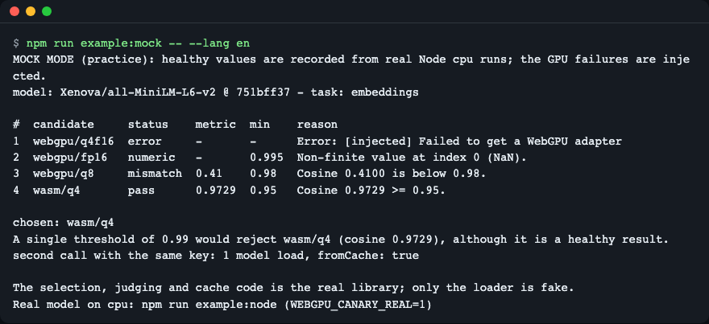
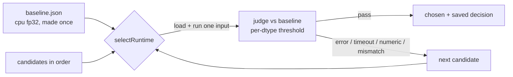
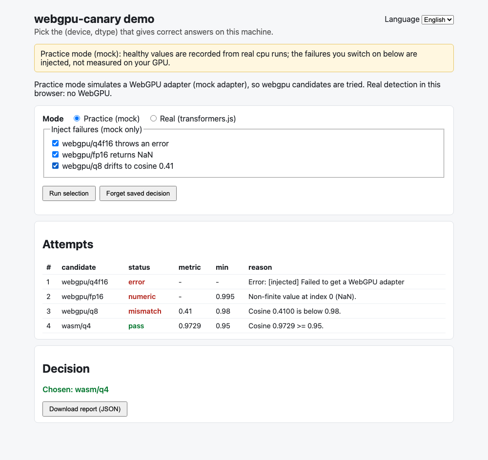
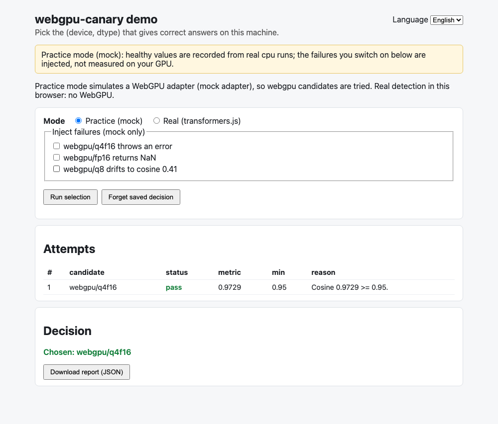

# webgpu-canary

**English** | [한국어](README.ko.md)

Pick the device and dtype that give **correct answers on this machine** for [transformers.js](https://huggingface.co/docs/transformers.js) in the browser. At app start, `selectRuntime()` loads each (device, dtype) candidate in turn, runs one short fixed input, and compares the result with a reference output made once on cpu with fp32. The first candidate whose output agrees wins, and the decision is remembered for the next visit.

A plain `try { webgpu } catch { wasm }` only catches errors. Some GPU/dtype combinations return **no error but wrong numbers** (NaN, or the same token repeated). This library catches those too.



*The practice (mock) run: the first three candidates fail in three different ways, the fourth passes.*

## Install

```bash
npm install webgpu-canary
npm install @huggingface/transformers   # only if you use the transformers.js loader
npm install react                       # only if you use the React hook
```

Requires Node 20+ for the CLI and tests; the library itself runs in any browser (WebGPU where available, WASM everywhere). The core has **zero runtime dependencies**; `@huggingface/transformers` (^4.3.2) and `react` (>=18) are optional peers.

Try it without installing anything into your project:

```bash
git clone https://github.com/LeeGyeongPil/webgpu-canary.git
cd webgpu-canary
npm install
npm run example:mock
```

Installing straight from GitHub (`npm install github:LeeGyeongPil/webgpu-canary`) also works: the `prepare` script builds `dist/` during the install. The npm registry package is the simpler route.

## Quick start

Three steps: make a baseline once, then pass it to `selectRuntime()` with your candidates in order of preference.

```bash
# 1. Reference output (cpu, fp32). Pin the model revision (a commit sha). Do this at build time.
npx webgpu-canary baseline Xenova/all-MiniLM-L6-v2 --task embeddings \
  --revision 751bff37182d3f1213fa05d7196b954e230abad9 --lang en --out baseline.json
```

```text
Wrote baseline.json (embeddings, 384 values, revision 751bff37182d3f1213fa05d7196b954e230abad9).
```

```js
// 2. At app start (shown here in Node; in a browser use device "wasm" instead of "cpu")
import { selectRuntime } from 'webgpu-canary';
import { transformersLoader } from 'webgpu-canary/transformers';
import baseline from './baseline.json' with { type: 'json' };

const { candidate, runner, report } = await selectRuntime({
  modelId: baseline.modelId,
  revision: baseline.revision,
  task: 'embeddings',
  baseline,
  loader: transformersLoader(),
  candidates: [
    { device: 'webgpu', dtype: 'fp16' },
    { device: 'cpu', dtype: 'q4' },
  ],
});
console.log('chosen:', candidate);
console.log(report.attempts.map((a) => a.status));
await runner.dispose();
```

```text
chosen: { device: 'cpu', dtype: 'q4' }
[ 'skipped', 'pass' ]
```

Node has no `navigator.gpu`, so the WebGPU candidate is `skipped` (`no-webgpu`) without loading anything. In a browser with WebGPU it is loaded and checked. In a restricted environment where WebGPU is advertised but cannot start, the status is `error` and the next candidate is tried.

## Core concepts



- **Candidate**: one `{ device, dtype }` pair, such as `webgpu/fp16` or `wasm/q4`. Order = preference.
- **Baseline**: the reference output of the same model and input on cpu with fp32. It is a small JSON file you create once with the CLI and ship with your app.
- **Statuses**: `pass`, `error` (load or run threw), `timeout`, `numeric` (NaN, Infinity, zero vector, or one token repeated many times), `mismatch` (finite but too far from the baseline), `skipped` (cannot work here, nothing loaded).
- **Per-dtype thresholds**: quantized dtypes drift from fp32 by design. Measured on `Xenova/all-MiniLM-L6-v2` (cosine to fp32, Node cpu, 2026-11-16): q8 0.9906, fp16 0.999999, q4 0.9729, q4f16 0.9729. A single threshold of 0.99 would reject a healthy q4, so each dtype has its own default (see [API](#api)).
- **Decision cache**: the choice is stored under a key made of the adapter, browser major version, model, model revision, task and library version. If any of them changes, the check runs again. A stored choice is verified with one input on every visit and dropped if it now fails.

## API

Imports come from `webgpu-canary` unless noted.

| Name | What it does | Main arguments | Returns |
|---|---|---|---|
| `selectRuntime(options)` | Tries candidates in order, returns the first that passes | `modelId`, `revision`, `task` (`embeddings` or `text-generation`), `candidates`, `baseline`, `loader`; optional `store`, `env`, `availableDtypes`, `thresholds`, `timeoutMs` (120000), `graceMs` (5000), `libVersion`, `onAttempt`, `signal` | `Promise<{ runner, candidate, report }>`; throws `NoCandidatePassedError`, `CanaryConfigError`, `CanaryAbortedError` |
| `judgeEmbedding(vec, base, dtype, overrides?)` | Judges an embedding (cosine) | vector, baseline vector, dtype | `Verdict` (`status`, `reason`, metric) |
| `judgeGeneration(tokens, base, dtype, overrides?)` | Judges greedy tokens (leading match, repeated-token runs) | token ids, baseline ids, dtype | `Verdict` |
| `DEFAULT_THRESHOLDS`, `resolveThreshold(dtype, overrides?)` | Per-dtype minimums (`minCosine`, `minPrefix`) | dtype string or per-module object | `{ minCosine, minPrefix }`; throws `CanaryConfigError` for a dtype with no default |
| `makeBaseline(options)` | Builds a baseline in code (the CLI uses it) | `modelId`, `revision`, `task`, `loader`, `libVersion`, optional `input`, `maxNewTokens` | `Promise<Baseline>` |
| `detectEnv()` / `emptyEnv()` | Looks at the browser: WebGPU, `shader-f16`, adapter info | none | `Promise<EnvInfo>` / `EnvInfo` |
| `cacheKey(parts)` | The decision key | `env`, `modelId`, `revision`, `task`, `libVersion` | `string` |
| `memoryStore()`, `localStorageStore(prefix?)` | Where decisions are remembered | - | `DecisionStore` |
| `formatAttempts(attempts, lang)`, `reasonText(attempt, lang)`, `candidateName(c)`, `t`, `resolveLang`, `LANGS` | Text table of attempts, the reason of one attempt in the chosen language, and English/Korean messages (the report keeps the English `reason` too) | - | `string[]` / `string` |
| `transformersLoader(options?)` (`webgpu-canary/transformers`) | Loader for `@huggingface/transformers` v4: mean-pooled normalized embeddings, greedy generation (uses the chat template when the tokenizer has one) | `progress_callback`, `cacheDir`, `module` | `Loader` |
| `useCanaryRuntime(options)` (`webgpu-canary/react`) | React hook: runs the selection on mount, disposes on unmount | same as `selectRuntime` plus `enabled` | `{ status: 'idle'\|'probing'\|'ready'\|'failed', attempts, runner, candidate, report, error }` |
| `fakeLoader(plan)`, `fixtures`, `runMockDemo` (`webgpu-canary/testing`) | Fake loader with injectable failures (`error`, `nan`, `zero`, `repeat`, `drift`, `delay`) and recorded real vectors | `plan: Record<'device/dtype', Behavior>` | `FakeLoader` with `stats` |
| `webgpu-canary baseline <modelId>` (CLI) | Writes the baseline JSON | `--task`, `--revision` (required), `--input`, `--max-new-tokens`, `--out`, `--lang en\|ko` | exit 0 ok, 1 model failed, 2 bad arguments |

Types such as `Candidate`, `Baseline`, `Report`, `Attempt`, `Status`, `Loader`, `Runner` and `DecisionStore` are exported too. You can write your own `Loader` (for example for a model runtime other than transformers.js); the judging and selection code never touches transformers.js.

Default thresholds (override with `thresholds: { q4: { minCosine: 0.9 } }`):

| dtype | minCosine | minPrefix (tokens) |
|---|---|---|
| fp32 | 0.999 | 4 |
| fp16 | 0.995 | 4 |
| q8, int8, uint8 | 0.98 | 3 |
| q4, bnb4, q4f16 | 0.95 | 3 |

A dtype that is not listed (for example `q2`) throws `CanaryConfigError` before anything loads: measure how far it drifts and pass your own threshold.

## Usage examples

### 1. Practice with injected failures (no network)

```bash
npm run example:mock
```

```text
MOCK MODE (practice): healthy values are recorded from real Node cpu runs; the GPU failures are injected.
model: Xenova/all-MiniLM-L6-v2 @ 751bff37 - task: embeddings

#  candidate     status    metric  min    reason
1  webgpu/q4f16  error     -       -      Error: [injected] Failed to get a WebGPU adapter
2  webgpu/fp16   numeric   -       0.995  Non-finite value at index 0 (NaN).
3  webgpu/q8     mismatch  0.41    0.98   Cosine 0.4100 is below 0.98.
4  wasm/q4       pass      0.9729  0.95   Cosine 0.9729 >= 0.95.

chosen: wasm/q4
A single threshold of 0.99 would reject wasm/q4 (cosine 0.9729), although it is a healthy result.
second call with the same key: 1 model load, fromCache: true

The selection, judging and cache code is the real library; only the loader is fake.
Real model on cpu: npm run example:node (WEBGPU_CANARY_REAL=1)
```

This is a **practice (mock) mode**: the healthy vectors are real recordings from Node cpu runs, but the three GPU failures are injected, because a real broken GPU cannot be reproduced on demand. The selection, judging and cache code is the real library.

### 2. Real model on Node cpu

```bash
WEBGPU_CANARY_REAL=1 NODE_USE_ENV_PROXY=1 npm run example:node
```

Downloads `Xenova/all-MiniLM-L6-v2` once, tries `webgpu/fp16`, `cpu/q4`, `cpu/q8`, prints the table and writes `out/report.json`. In our run, `cpu/q4` passed with cosine 0.9729; the WebGPU candidate recorded an `error` because that environment had no WebGPU adapter. Set `NODE_USE_ENV_PROXY=1` when you are behind an HTTP(S) proxy (Node's built-in fetch then uses it).

### 3. React hook

```tsx
import { useCanaryRuntime } from 'webgpu-canary/react';
import { transformersLoader } from 'webgpu-canary/transformers';
import { localStorageStore } from 'webgpu-canary';

function Search({ baseline }) {
  const canary = useCanaryRuntime({
    modelId: baseline.modelId, revision: baseline.revision, task: 'embeddings', baseline,
    loader: transformersLoader(), store: localStorageStore(),
    candidates: [{ device: 'webgpu', dtype: 'fp16' }, { device: 'wasm', dtype: 'q8' }],
  });
  if (canary.status === 'failed') return <p>No safe runtime here: {canary.error?.message}</p>;
  if (canary.status !== 'ready') return <p>Checking this device… {canary.attempts.length} tried</p>;
  // canary.runner.run('text', {}) gives { vector }
  return <p>Using {canary.candidate.device}/{canary.candidate.dtype}</p>;
}
```

The hook's state transitions (`idle` → `probing` → `ready`/`failed`, live `attempts`, dispose on unmount) are covered by `test/react.test.tsx`. This snippet is an illustration of the API and was not run in a browser.

### 4. Browser demo page (English and Korean)

```bash
npm run demo:build   # static files in demo-dist/
npm run demo:dev     # or a local dev server
```



*The demo page, practice mode with all three injected failures on.*



*With the injected failures off, the first candidate passes and nothing else is tried.*

The page has a language menu (English / 한국어, remembered in `localStorage`; `?lang=ko` in the address wins). The default mode is the practice (mock) mode: it simulates a WebGPU adapter and injects the failures, and it says so on the page together with the real detection result. Its "real mode" runs transformers.js in your browser and downloads the model.

**Real WebGPU was not verified** on the machine this release was prepared on. To check it yourself, run `npm run demo:build`, serve `demo-dist/` (or run `npm run demo:dev`), open it in Chrome/Edge or Safari 26+ on a normal desktop session (not inside a sandbox or remote container), switch to real mode and read the attempts table. Chrome/Edge and Safari 26+ ship WebGPU; every browser can use the WASM candidates.

## Language

CLI and examples: `--lang en|ko`, then `WEBGPU_CANARY_LANG`, then `LC_ALL` / `LC_MESSAGES` / `LANG` (Korean if it starts with `ko`, otherwise English). The demo page uses the language menu.

```bash
npm run example:mock -- --lang ko
```

## When to use it

- Good fit: a web app that runs transformers.js (embeddings or small text generation) on the client and must not show wrong results on some users' GPUs; you want the choice to be measured, cached, and explained by a report.
- Not the goal: raw speed benchmarking. Per-candidate load times are recorded but candidates are tried in your preferred order, not raced.
- Other tools: to see what WebGPU features a browser reports, see [webgpureport.org](https://webgpureport.org/); for the model runtime itself, see [transformers.js](https://huggingface.co/docs/transformers.js) and [ONNX Runtime Web](https://onnxruntime.ai/docs/tutorials/web/). Their current features may differ; check their docs.

## Limitations

- Pin the model `revision` (a commit sha, not `main`): the revision is part of the decision-cache key and the baseline is made for exactly that revision. The fix for [ONNX Runtime #26732](https://github.com/microsoft/onnxruntime/issues/26732) (silent wrong fp16 output on WebGPU) came as a re-exported model in a new Hub revision. Because the revision is part of the key, moving your pin re-runs the check instead of reusing an old decision, and pinning a sha keeps the baseline and the runtime model on one exact revision. The CLI prints a warning when `--revision` is not a 40-character sha.
- To forget old decisions, call `store.clear()` (both stores have it) or press "Forget saved decision" on the demo page. A changed adapter, browser major version, model, revision or library version already makes the check run again by itself.
- `detectEnv()` may return empty strings for adapter `vendor`, `architecture`, `device` and `description` (browsers can hide them). The cache key then rests on the other parts, so decisions are shared by GPUs that look identical to the browser.
- GPU-only numeric failures cannot be reproduced on cpu, so they are checked with injected failures (`[injected]` in the output). Default thresholds come from cpu measurements.
- Each candidate downloads its own model files. A download budget and smaller-first ordering are planned for 0.2.0.
- Only embeddings and greedy text generation are checked in 0.1.0 (classification is planned).
- For small instruct models, check with a chat-template input, not plain text: in our run a plain-text prompt made fp32 and q4 disagree from the first token, while the chat-template prompt produced identical tokens on fp32, fp16, q4 and q4f16. The transformers.js loader applies the template when the tokenizer has one.

## Troubleshooting

| Symptom | Cause | Fix |
|---|---|---|
| `fetch failed` and every candidate is `error` on Node | Node's fetch ignores proxy variables by default | `NODE_USE_ENV_PROXY=1` |
| `CanaryConfigError: No default threshold for dtype "q2"` | The dtype has no built-in threshold | Measure the drift and pass `thresholds: { q2: { minCosine: …, minPrefix: … } }` |
| `NoCandidatePassedError` | Every candidate failed | Read `error.report.attempts`; add a candidate that works everywhere, such as `wasm/q8` |
| `skipped` with `no-webgpu` / `no-shader-f16` | The browser lacks WebGPU or `shader-f16` | Expected; the next candidate is tried |
| `Cannot import @huggingface/transformers` | The optional peer is not installed | `npm install @huggingface/transformers` |
| `NODE_USE_ENV_PROXY=1` has no effect | Older Node versions do not know this variable (it is listed in the Node 22 and later CLI docs; Node 20 is not covered) | Use a current Node release, or set the proxy through your own fetch setup |
| Warning `--revision ... is not a 40-character commit sha` | You passed a branch or tag | Use the commit sha from the model page's history |
| Example prints Korean | Your `LANG` starts with `ko` | `--lang en` |

## Versions and compatibility

- Follows [Semantic Versioning](https://semver.org/). While 0.x, the API may change in a minor version; changes are listed in [CHANGELOG.md](CHANGELOG.md).
- Built and tested with `@huggingface/transformers` 4.3.2, TypeScript 7.0.2, Node v26.13.0 (2026-11-16).

## Development and contributing

```bash
npm install
npm test               # 63 tests (+1 real-model test skipped unless WEBGPU_CANARY_REAL=1)
npm run typecheck
npm run build && node scripts/check-package.mjs   # prints "package ok"
npm run demo:build
```

## Further reading

- [transformers.js documentation](https://huggingface.co/docs/transformers.js) (checked 2026-11-16)
- [ONNX Runtime issue #26732](https://github.com/microsoft/onnxruntime/issues/26732): WebGPU output that is wrong without an error (checked 2026-11-16)
- [WebGPU on MDN](https://developer.mozilla.org/en-US/docs/Web/API/WebGPU_API)

## License

MIT.
